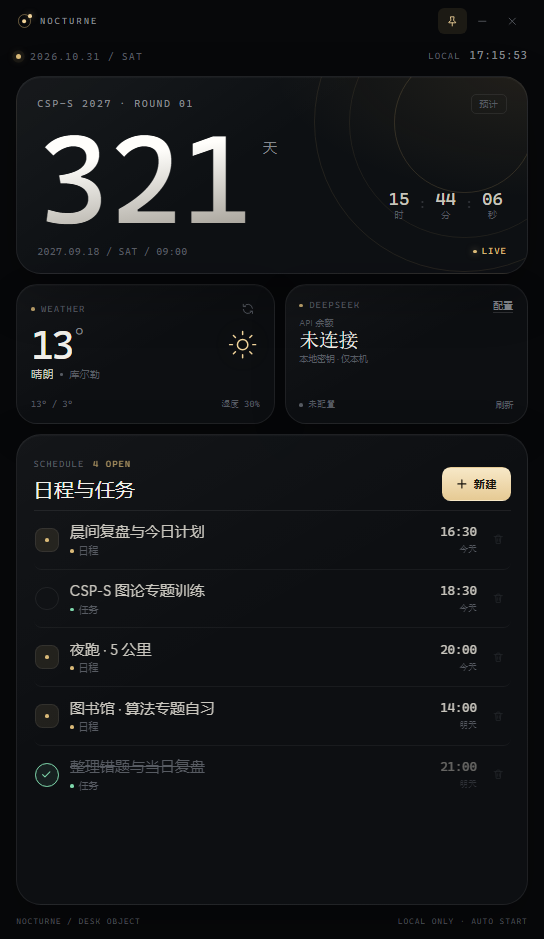

# NOCTURNE

无边框、置顶、登录自启的暗黑桌面小浮窗：CSP-S 倒计时、库尔勒天气、DeepSeek 余额和本地日程都在一块 432 × 748 的面板里。



## 安装（推荐）

从 [Releases](https://github.com/bc-hio/vesper/releases/latest) 下载 `NOCTURNE-Setup-1.0.0.exe`。

> 安装包 115.82 MiB，超过 GitHub 单文件 100 MiB 的上限，因此不纳入仓库，只作为 Release 附件提供。
> 下载后建议核对 SHA-256（校验值见仓库根目录的 `NOCTURNE-Setup-1.0.0.sha256`）：

```powershell
Get-FileHash .\NOCTURNE-Setup-1.0.0.exe -Algorithm SHA256
```

安装流程：

1. 双击安装包，选择「仅为我安装」。
2. 在「选定安装位置」页面选择任意当前用户可写的目录，例如 `D:\Apps\NOCTURNE`。
3. 点击安装。完成后所选目录下会出现 `NOCTURNE.exe` 和 `resources` 等运行文件。
4. 安装器会创建开始菜单快捷方式，并写入当前用户登录自启动项。
5. 安装完成后可直接从开始菜单搜索 **NOCTURNE** 启动。

安装版不依赖 Node.js，本地服务与 UI 都在 Electron 进程内运行。

### 自启动

安装器写入：

```text
HKCU\Software\Microsoft\Windows\CurrentVersion\Run
  NOCTURNE = "<安装目录>\NOCTURNE.exe" --no-sandbox --disable-gpu
```

应用首次启动时也会检查并自动修复该启动项所指向的路径，因此即使安装后移动了快捷方式，也能恢复为当前安装位置。卸载时安装器会删除该启动项，但保留日程与余额配置数据。

### 卸载

在 Windows「设置 → 应用」中卸载 **NOCTURNE**，或运行安装目录里的 `Uninstall NOCTURNE.exe`。

用户数据保存在：

```text
%APPDATA%\NOCTURNE
```

卸载默认不会删除该目录，重新安装后日程仍会恢复。若要彻底清除，可手动删除。

> 当前安装包未做代码签名，Windows SmartScreen 可能提示未知发布者。选择「更多信息 → 仍要运行」即可。

## 从源码运行

需要 Node.js 20+ 与 `npm install`：

```powershell
npm install
npm run widget
```

完整网页版：

```powershell
npm start
```

然后访问 <http://127.0.0.1:4173/>。

## 构建安装包

```powershell
npm install
npm run dist
```

生成：

```text
dist\NOCTURNE-Setup-1.0.0.exe
```

使用 electron-builder + NSIS。安装器配置在 `electron-builder.yml`，安装路径选择、开始菜单快捷方式和自启动逻辑都在其中；自启动 NSIS 宏在 `build/installer.nsh`。

## 功能

| 模块 | 行为 |
| --- | --- |
| CSP-S 倒计时 | 目标 `2027-09-18 09:00 +08:00`，实时刷新天/时/分/秒。该日期按 CSP-S 第一轮通常在九月第三个周六的惯例估算，界面标注「预计」；官方公布后修改 `config.js` 的 `targetISO`。 |
| 天气 | Open-Meteo 实时天气，坐标 `41.74, 86.17`（库尔勒），展示温度、天气状况、高低温与湿度。 |
| DeepSeek 余额 | 点击「配置」输入 API Key，保存在当前安装配置的 LocalStorage 中；本地代理读取 `/user/balance`，支持余额、赠送/充值拆分、错误态和移除密钥。 |
| 日程与任务 | 「新建」添加日程或任务，支持完成、删除、按日期时间排序；数据持久化并在打开时自动恢复。 |
| 窗口控制 | 图钉切换置顶；`–` 收起到托盘；`×` 退出；开始菜单可重新打开。 |

## 数据与安全

- 安装版数据目录：`%APPDATA%\NOCTURNE`（含 Electron profile 与日志）。
- 源码版数据目录：项目内 `.data`。
- DeepSeek Key 只存在本机 LocalStorage；本地 Node HTTP 代理仅转发请求，不落盘、不打印。
- 应用只加载本机 `127.0.0.1` 页面，并以 `--no-sandbox --disable-gpu` 兼容受限 Windows 会话。不要把本地服务暴露到公网。
- 天气接口需要联网；断网时其他模块仍可使用。

## 测试

```powershell
npm run test:all
```

测试覆盖完整仪表盘、紧凑浮窗布局、Electron 无边框窗口、置顶 IPC、本地服务自启/退出、LocalStorage 持久化、响应式溢出与截图。打包后的 `NOCTURNE.exe` 也已在安装目录方式下验证：独立启动、内置 HTTP 服务、桌面浮窗截图均正常。

本次自动化环境对 `AppData` 和注册表的外部写入有限制，因此安装路径选择页与安装目录文件生成已在工作区路径下验证；实际登录自启动会在用户正常桌面会话安装时写入。

## 文件

```text
dist\NOCTURNE-Setup-1.0.0.exe   最终安装包
desktop/main.cjs                Electron 主进程、无边框窗口、内置服务、自启动注册
desktop/preload.cjs             窗口控制 IPC 桥
widget.html / widget.css        浮窗界面
widget.js                       浮窗逻辑
config.js                       倒计时目标、天气接口、存储键
index.html / styles.css / app.js 完整版仪表盘
server.mjs                      静态服务 + DeepSeek 同源代理
build/installer.nsh             NSIS 自启动安装/卸载宏
electron-builder.yml            安装包配置
scripts/                        源码版开发启动脚本与自启动工具
tests/                          无头浏览器与 Electron 端到端测试
```
